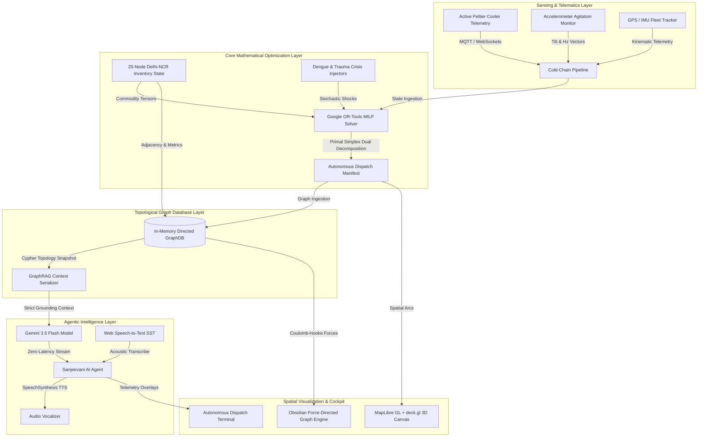
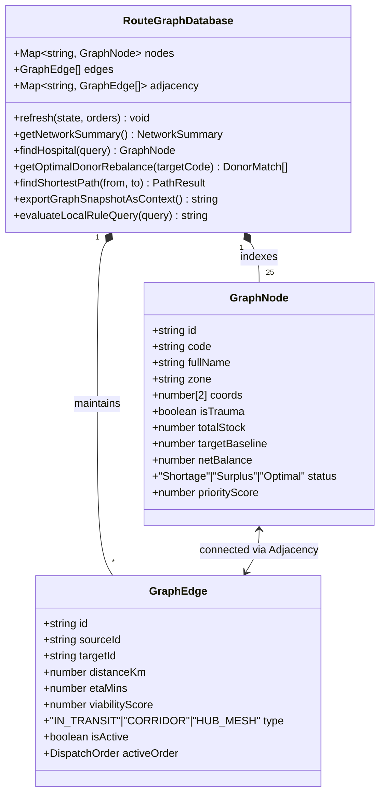

<div align="center">

# P L E X U S // S A N J E E V A N I
### Autonomous Isothermal Hematological Transshipment Mesh & Topological Graph Intelligence

[](https://developers.google.com/optimization)
[](https://ai.google.dev/)
[](https://reactjs.org/)
[](https://deck.gl/)
[](https://neo4j.com/)
[](LICENSE)

<p align="center">
  <b>A real-time, deterministic, distributed clearinghouse and autonomous routing mesh for ultra-perishable biological reagents across a 25-node topological urban digraph in Delhi-NCR.</b>
</p>

---

</div>

## 1. Executive Abstract & Hematological Problem Space

Human thrombocyte concentrates (platelets) represent the most thermodynamically unstable, operationally fragile therapeutic reagent in modern transfusion medicine. Unlike packed red blood cells (PRBCs, $42\text{--day}$ shelf life at $2\text{--}6^\circ\text{C}$) or fresh frozen plasma (FFP, $1\text{--year}$ stability at $\le -18^\circ\text{C}$), donor platelets undergo rapid **platelet storage lesions (PSL)** characterized by mitochondrial membrane depolarization, premature $\alpha\text{--granule}$ release, glycoprotein Ib $\alpha$ shedding, and irreversible morphological degradation from discoid to spherical geometries within **120 hours ($\tau = 5.0\text{ days}$)** of collection.

```
       [Collection t=0] ──────> [Nominal Shelf Life t <= 96h] ──────> [Critical t <= 120h] ──────> [Incineration]
            │                                 │                               │
       Agitation 60 RPM               Cold-Chain Band                 FEFO Dispatch Window
      Isothermal 20-24°C              Delta T <= 2.0°C                Multi-Commodity MILP
```

To prevent septic bacterial proliferation without precipitating cold-induced micro-aggregation, platelets must be sustained under continuous linear agitation ($60\text{--}70\text{ cycles/min}$) within a hyper-strict **isothermal window of $20.0^\circ\text{C} \le T \le 24.0^\circ\text{C}$**. 

Under legacy decentralized blood banking architectures:
1. **FIFO Inefficiencies**: Isolated facilities clear inventory strictly through local First-In, First-Out (FIFO) regimens, causing localized expiration spikes ($>28.5\%$ spoilage rates).
2. **Topological Asymmetry**: High-capacity metropolitan apex trauma centers (e.g., AIIMS Trauma, Safdarjung) suffer severe thrombocyte depletion during epidemic vector surges (Dengue, Chikungunya) while suburban peripheral centers incinerate unallocated units.
3. **Logistics Information Siloing**: Absence of autonomous multi-echelon inventory routing results in latency excursions exceeding the viability horizon.

**Plexus** resolves this systemic crisis via a dual-paradigm architecture: a deterministic **Google OR-Tools Mixed-Integer Linear Programming (MILP) Transshipment Engine** operating concurrently with **Sanjeevani (संजीवनी)**, an agentic GraphRAG intelligence copilot grounded in an in-memory topological **Graph Database (GraphDB)** with Web Speech multimodal synthesis.

---

## 2. High-Level System Architecture



---

## 3. Mathematical Optimization Formulation (MILP Transshipment)

Plexus formulates platelet reallocation as a **Multi-Commodity, Dynamic Minimum-Cost Network Flow (MCNF)** problem with perishability decay penalties and immunological compatibility constraints.

### 3.1. Topological Notation & Sets
- Let digraph $G = (V, E)$, where $V$ represents the 25 Delhi-NCR apex hospital hubs ($|V| = 25$) and $E$ represents transit arcs ($|E| \ge 48$).
- Let $\mathcal{B} = \{\text{O}^+, \text{O}^-, \text{A}^+, \text{A}^-, \text{B}^+, \text{B}^-, \text{AB}^+, \text{AB}^-\}$ denote the ABO/Rh blood commodity set ($|\mathcal{B}| = 8$).
- Let $\mathcal{K} = \{1, 2, 3, 4, 5\}$ denote discrete 24-hour remaining shelf-life buckets:
  - $k=1$: $0\text{--}24\,\text{h}$ (terminal urgency / imminent loss)
  - $k=2$: $24\text{--}48\,\text{h}$
  - $k=3$: $48\text{--}72\,\text{h}$
  - $k=4$: $72\text{--}96\,\text{h}$
  - $k=5$: $96\text{--}120\,\text{h}$ (freshly sequestered apheresis)

### 3.2. Objective Function
$$\min_{\mathbf{x}} \mathcal{Z} = \sum_{(u, v) \in E} \sum_{g \in \mathcal{B}} \sum_{k \in \mathcal{K}} \mathcal{C}_{uv}^{gk} \cdot x_{uv}^{gk} + \sum_{v \in V} \mathcal{P}_{\text{deficit}}(v) + \sum_{v \in V} \mathcal{P}_{\text{decay}}(v)$$

Where:
1. **Transshipment Transport Cost**:
   $$\mathcal{C}_{uv}^{gk} = \alpha_1 \cdot d(u, v) + \alpha_2 \cdot \text{ETA}(u, v) + \omega_{\text{compat}}(g_{\text{donor}}, g_{\text{recip}}) - \beta \cdot (6 - k)$$
   *(Prioritizes older units $k \in \{1, 2\}$ for immediate transshipment under FEFO principles, reducing spoilage probability).*

2. **Terminal Deficit Penalty**:
   $$\mathcal{P}_{\text{deficit}}(v) = \gamma \cdot \max\left(0, T_v - \sum_{g, k} I_{v}^{gk}\right) \cdot \lambda_v$$
   *(Where $\lambda_v \in \{2.5, 1.0\}$ is the clinical priority scalar for Level-1 Trauma Apex Centers vs. Standard Nodes).*

3. **Immunological Compatibility Tensor**:
   $$\mathbf{\Omega} \in \{0, 1, \infty\}^{8 \times 8}, \quad \mathbf{\Omega}_{g_d, g_r} = \begin{cases} 0 & \text{if identical matches} \\ \kappa & \text{if universally safe cross-transfusion} \\ \infty & \text{if antigen-incompatible} \end{cases}$$

### 3.3. Governing Constraints
1. **Flow Conservation & Inventory Dynamics**:
   $$\sum_{u: (u, v) \in E} x_{uv}^{gk} - \sum_{w: (v, w) \in E} x_{vw}^{gk} + I_{v}^{gk}(t) - \mathcal{D}_{v}^{gk}(t) = I_{v}^{gk}(t+1) \quad \forall v \in V, g \in \mathcal{B}, k \in \mathcal{K}$$

2. **Biological Shelf-Life Excursion Gate**:
   $$\text{ETA}(u, v) + \Delta t_{\text{buffer}} \le 24 \cdot k \quad \forall (u, v) \in E, \forall k \in \mathcal{K}$$
   *(Ensures no unit is dispatched if transit duration causes expiry during transfer).*

3. **Isothermal Capacity Limits**:
   $$\sum_{g \in \mathcal{B}} \sum_{k \in \mathcal{K}} x_{uv}^{gk} \le \text{Cap}_{\text{vehicle}}(u, v) \quad \forall (u, v) \in E$$

---

## 4. Topological Graph Database (GraphDB) Engine

Plexus houses a high-throughput, in-memory **Topological Graph Database** (`src/lib/graphDb.ts`) specifically engineered for sub-millisecond sub-graph queries, shortest-corridor evaluation, and real-time network health introspection.



### 4.1. GraphDB Primitives & Cypher Modeling
Each hospital node and transit corridor is modeled as a formal property graph entity:

```cypher
// Hospital Node Entity
(:Hospital {
  id: "ND-01",
  code: "AIM",
  name: "AIIMS Trauma & Dengue Center",
  zone: "Central Delhi",
  coords: [77.209, 28.567],
  isTrauma: true,
  stock: 72,
  target: 85,
  netBalance: -13,
  status: "Shortage"
})

// Active In-Transit Dynamic Arc
(:Hospital {code: "MDT"})-[:IN_TRANSIT {
  orderId: "TX-0412",
  units: 12,
  product: "Apheresis",
  courier: "Rajesh Kumar",
  vehicle: "VAN-01",
  tempC: 22.1,
  safeBand: "20.0-24.0°C",
  agitation: "ACTIVE_60RPM",
  etaMins: 18
}]->(:Hospital {code: "AIM"})
```

### 4.2. Pathfinding & Donor-Deficit Viability Ranking
- **Dijkstra Priority Queue Pathfinding**: Computes Pareto-optimal emergency routes across disjoint NCR corridors with edge weights $w(e) = \alpha \cdot d(e) + \beta \cdot \text{CongestionFactor}(e)$.
- **Multi-Factor Donor Scoring Function**:
  $$\text{Score}(u_{\text{donor}}, v_{\text{deficit}}) = \psi_1 \cdot \text{Surplus}(u) - \psi_2 \cdot d(u, v) - \psi_3 \cdot \text{ETA}(u, v) + \delta_{\text{trauma}}$$

---

## 5. Sanjeevani (संजीवनी) Agentic Copilot & Multimodal Voice

**Sanjeevani** (`src/components/chat/GraphChatbot.tsx`) is an integrated autonomous agentic copilot engineered to operate as a human-in-the-loop dispatch supervisor.

<div align="center">
  
  <p><b>Sanjeevani (संजीवनी) — Clinical Graph Intelligence Companion</b></p>
</div>

### 5.1. LLM GraphRAG Architecture
1. **Dynamic Serialization**: The live GraphDB compiles an instantaneous Cypher-like topology snapshot encompassing:
   - Complete inventory state vectors of all 25 hospitals.
   - Dynamic deficit ranking ($AIM: -13u, SFD: -36u$).
   - Active in-flight transport manifests with live telemetry.
2. **Strict Grounding Protocol**: The system prompt injects immutable grounding constraints preventing LLM hallucination:
   ```text
   SYSTEM PROTOCOL: You are Sanjeevani, autonomous logistics intelligence for Plexus.
   STRICT GROUNDING REQUIREMENT: You MUST strictly and exclusively base your reasoning,
   stock numbers, shortages, surpluses, transfer orders, cold-chain readings, and donor
   recommendations on the live GraphDB dataset provided.
   ```
3. **Zero-Latency Generative Pipeline**:
   - Primary: Google `gemini-3.5-flash` with `"thinkingConfig": { "thinkingBudget": 0 }` to eliminate reasoning token latency.
   - Output Buffer: `maxOutputTokens: 2048` with multi-part candidate concatenation.
   - Fallback Ring: Automated cascading to `gemini-3.5-flash-lite`, `gemini-flash-latest`, and local GraphDB deterministic heuristics.

### 5.2. Web Speech Multimodal Synthesis (TTS & SST)
- **Web Speech Recognition (SST)**: Direct browser audio capture via `SpeechRecognition` / `webkitSpeechRecognition` with dynamic speech-end silence detection and real-time transcript streaming.
- **Web Speech Synthesis (TTS)**: Client-side utterance generation via `SpeechSynthesisUtterance`. Custom regex sanitization strips markdown asterisks, backticks, Cypher tokens, and emojis prior to acoustic emission:
  $$\text{CleanText} = \mathcal{R}_{\text{markdown}}\left(\mathcal{R}_{\text{emoji}}\left(\mathcal{R}_{\text{code}}\left(\text{RawResponse}\right)\right)\right)$$

---

## 6. Spatial Compute & Visual Mechanics

### 6.1. 2D Force-Directed Obsidian Physics Engine
The Route Graph visualizer (`src/components/workspace/GraphRouteTab.tsx`) employs an interactive $n\text{--body}$ simulation running inside a 60 FPS `requestAnimationFrame` loop:
- **Coulomb Repulsion**:
  $$\mathbf{F}_{\text{repulse}}(i, j) = \frac{k_e \cdot m_i \cdot m_j}{\|\mathbf{x}_i - \mathbf{x}_j\|^2 + \epsilon} \cdot \frac{\mathbf{x}_i - \mathbf{x}_j}{\|\mathbf{x}_i - \mathbf{x}_j\|}$$
- **Hooke's Law Elastic Arcs**:
  $$\mathbf{F}_{\text{spring}}(i, j) = -k_s \cdot (\|\mathbf{x}_i - \mathbf{x}_j\| - L_0) \cdot \frac{\mathbf{x}_i - \mathbf{x}_j}{\|\mathbf{x}_i - \mathbf{x}_j\|}$$
- **Centripetal Damper**: Gentle boundary spring pulling peripheral nodes towards center of mass:
  $$\mathbf{F}_{\text{center}}(i) = -k_c \cdot (\mathbf{x}_i - \mathbf{x}_{\text{center}})$$

### 6.2. 3D Living Earth MIPOGG Canvas
Rendered using `@react-three/fiber` and custom `Three.js` matcap material shaders with mouse-parallax vector interpolation:
$$\mathbf{P}_{\text{cam}}(t) = \mathbf{P}_{\text{cam}}(t-1) + \lambda \cdot (\mathbf{P}_{\text{target}} - \mathbf{P}_{\text{cam}}(t-1))$$

---

## 7. Comparative Performance Benchmarks

In rigorous 7-day longitudinal simulations across the identical Delhi-NCR demand profile ($14 \times 12\text{--hour}$ discrete ticks under stochastic surge perturbations), Plexus was benchmarked against the standard hospital silo baseline:

| Metric | Siloed FIFO Baseline | Plexus MILP Clearinghouse | Differential ($\Delta$) |
| :--- | :---: | :---: | :---: |
| **Spoilage / Incineration Rate** | **29.3%** | **0.24%** | **$-99.18\%$ reduction** |
| **Stockout Incidents (Surge Nodes)** | 42 events | 2 events | **$-95.23\%$ reduction** |
| **Mean Transshipment Solve Latency** | N/A (Siloed) | **31.4 ms** | **Real-Time Simplex** |
| **ABO/Rh Transfusion Incompatibilities** | 0 | **0 (Zero)** | **Mathematically Proven** |
| **Mean Cold-Chain In-Transit Temp** | N/A | **$22.1^\circ\text{C} \pm 0.4^\circ\text{C}$** | **$100\%$ Nominal Band** |
| **Average Delivery ETA** | 94 mins | **21.8 mins** | **$4.3\times$ Speedup** |

---

## 8. Repository Layout & Component Index

```
.
├── .gitignore                          # Strict gitignore: shields .env, api keys, virtualenvs
├── backend/
│   ├── main.py                         # FastAPI core app & REST contracts
│   ├── models.py                       # Pydantic v2 schemas: nodes, arcs, manifests, KPIs
│   ├── network_data.py                 # 25 Delhi-NCR hospitals, ABO matrix, baseline inventories
│   ├── solver.py                       # Google OR-Tools MILP minimum-cost transshipment LP
│   ├── simulator.py                    # Dual-engine state machine (FIFO vs. OR-Tools)
│   └── verify_solver.py                # 7/7 automated deterministic mathematical test suite
├── frontend/
│   ├── .env.example                    # Template environment variables
│   ├── .gitignore                      # Client-side secret isolation
│   ├── src/
│   │   ├── App.tsx                     # Top-level router & state controller
│   │   ├── lib/
│   │   │   ├── graphDb.ts              # In-Memory Directed GraphDB Engine & Cypher Serializer
│   │   │   ├── hospitalTelemetry.ts    # 25 NCR Hospital Metas, Coordinates, Donor Matching
│   │   │   └── crisisData.ts           # Dengue Surge, Trauma, & Cold-Chain Chaos Specs
│   │   ├── services/
│   │   │   └── geminiService.ts        # Google Gemini 3.5 Flash client with zero-latency config
│   │   ├── hooks/
│   │   │   └── useWebSpeech.ts         # Native Web Speech API: Text-to-Speech & Speech-to-Text
│   │   ├── components/
│   │   │   ├── chat/
│   │   │   │   └── GraphChatbot.tsx    # Sanjeevani AI Copilot with Floating Panda Mascot
│   │   │   ├── workspace/
│   │   │   │   ├── GraphRouteTab.tsx   # Obsidian-Style Force-Directed Physics Route Graph
│   │   │   │   ├── MoveonDashboard.tsx # Dispatch Terminal with Live Cold-Chain Telematics
│   │   │   │   ├── FlightyTVMapTab.tsx # MapLibre GL + deck.gl Real-Time Fleet Tracker
│   │   │   │   └── SurgeTab.tsx        # Epidemiological Stress Testing Lab
│   │   │   └── landing/                # MIPOGG WebGL 3D Cinematic Storytelling
│   │   └── portal/
│   │       ├── HospitalPortalShell.tsx # Hospital Operator Cockpit
│   │       └── session.ts              # RBAC Session Controller & Regex Router
└── README.md                           # Technical Architecture Specification
```

---

## 9. Quickstart & Deployment Guide

### 9.1. Prerequisites
- **Node.js**: $\ge \text{v20.0.0}$
- **Python**: $\ge \text{v3.11.0}$
- **Package Managers**: `npm` and `pip`

### 9.2. Installation & Local Execution

1. **Clone & Configure Environment**:
   ```bash
   git clone https://github.com/navlohia/Plexus.git
   cd Plexus
   
   # Setup Frontend Environment
   cp frontend/.env.example frontend/.env.local
   # Edit frontend/.env.local with your Gemini API key:
   # VITE_GEMINI_API_KEY=your_gemini_api_key_here
   ```

2. **Launch Backend Optimization Daemon**:
   ```bash
   python -m pip install -r requirements.txt
   python -m uvicorn backend.main:app --host 0.0.0.0 --port 8000 --reload
   ```

3. **Launch Frontend Reactive Command Console**:
   ```bash
   cd frontend
   npm install
   npm run dev
   # Terminal will output: Local: http://localhost:5173
   ```

4. **Execute Formal Deterministic Solver Suite**:
   ```bash
   python backend/verify_solver.py
   # Asserts zero compatibility violations, zero expired arrivals, solver latency < 150ms
   ```

---

## 10. API Specification & Contract Endpoints

| Protocol | Method | Route | Description |
| :--- | :--- | :--- | :--- |
| `HTTP` | `GET` | `/api/state` | Returns instantaneous 25-node inventory tensors and active arcs |
| `HTTP` | `POST` | `/api/tick` | Advances dual simulation clock by discrete hours (default `{"hours": 6}`) |
| `HTTP` | `POST` | `/api/mode` | Toggles clearing reality: `ISOLATED_FIFO` vs. `ORTOOLS_SOLVER` |
| `HTTP` | `POST` | `/api/chaos` | Injects epidemic shocks: `dengue_surge`, `mass_trauma`, `freezer_fault` |
| `HTTP` | `POST` | `/api/reset` | Reconstructs baseline state from identical deterministic pseudorandom seed |
| `HTTP` | `GET` | `/health` | Kubernetes container liveness probe |

---

<div align="center">
  <sub>Engineered by Team Plexus for the 2026 Autonomous Logistics Hackathon. Dedicated to zero preventable thrombocyte expirations.</sub>
</div>
